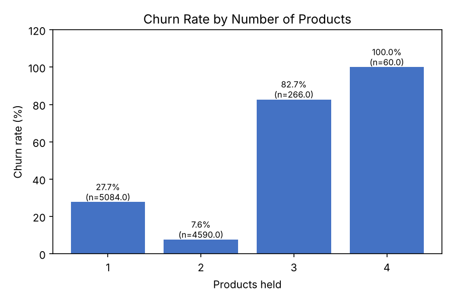
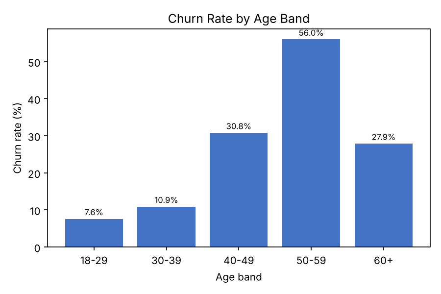
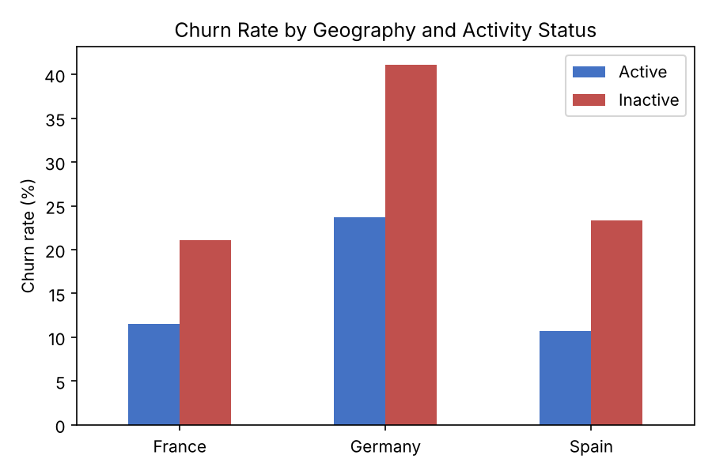
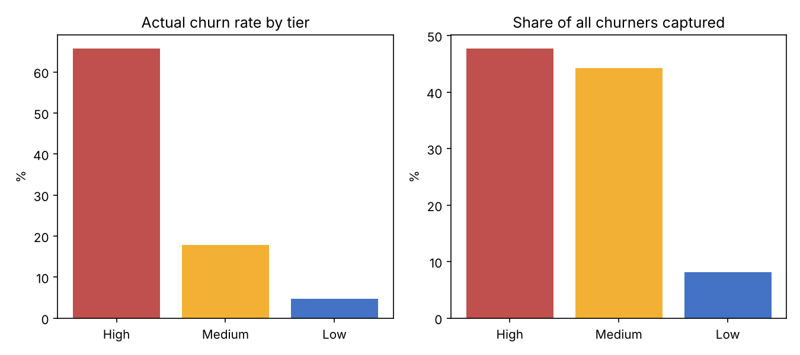

# Bank Customer Churn Analysis

SQL + Python analysis of which customer segments are most likely to churn, with an explainable risk tier and a retention recommendation. See [RECOMMENDATION.md](RECOMMENDATION.md) for the one-page business recommendation.

## Business Question
*Which customer segments have the highest churn risk, and what would a retention program targeting them look like?*

## Data
10,000 customers from the [Kaggle Bank Customer Churn dataset](https://www.kaggle.com/datasets/shantanudhakadd/bank-customer-churn-prediction): geography, gender, age, tenure, balance, number of products, card and activity flags, salary, and a churn flag. Columns are renamed to snake_case in `data/Churn_Modelling.csv`; there are no missing values or duplicate customers.

## Approach
1. Framed the business question first, then loaded the data into SQLite (queries also run on Snowflake and Postgres).
2. Wrote segment queries in [`sql/churn_analysis.sql`](sql/churn_analysis.sql) (Q1-Q8). [`scripts/run_analysis.py`](scripts/run_analysis.py) runs that file directly, saves each result to `sql/Qn_output.csv` and builds the charts.
3. Cross-checked segments against each other (activity within products, activity within geography) to avoid mistaking an overlap for a driver.
4. Built a simple, auditable risk tier and measured both its churn rate and the share of all churners it captures.

## Key Findings
- Overall churn is **20.4%** (2,037 customers), carrying $185.6M of $764.9M in balances.
- **Ages 40-59 churn at 31-56%** against 8-11% for under-40s; 60+ falls back to 27.9%.
- **Germany churns at 32.4%** against about 16% elsewhere, and is 40% of all churners. Activity does not explain it.
- **3-4 products churn at 83-100%;** 2 products at 7.6%; 1 product at 27.7% but 69% of all churners.
- **High-risk tier:** 14.8% of customers, 65.7% churn, 47.7% of all churners. Low tier: 4.7% churn.






## Recommendation (summary)
Contact the High tier first with a pilot and a holdout group, review how 3-4 product bundles are sold, and investigate Germany. Full details and measurement plan in [RECOMMENDATION.md](RECOMMENDATION.md).

## Limits
A single snapshot with no dates or churn reasons: this shows correlation, not cause. Offer cost figures are assumptions to replace with the bank's real numbers.

## Reproducing
```bash
pip install pandas matplotlib
python scripts/run_analysis.py
```

## Still To Do
- [ ] Rebuild the charts as a Power BI dashboard (churn by segment, risk tiers, a geography or age slicer) and add a screenshot
- [ ] Test the drivers together with a logistic regression
